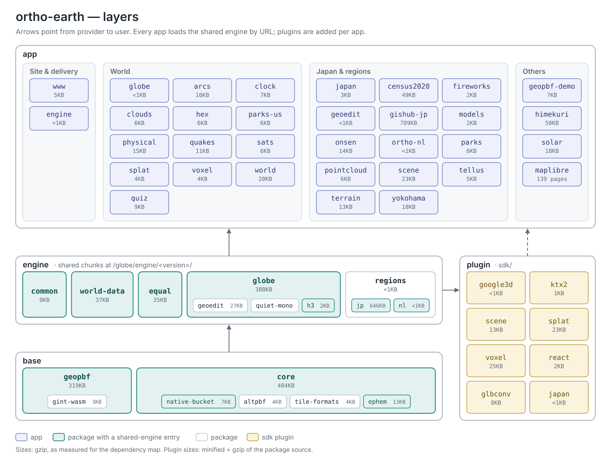

> [English](Architecture) · **日本語**

# 構成

リポジトリは 1 つの npm workspace です：`packages/*`（エンジンと共有部品）、`sdk/*`（外の利用者向けの SDK と道具）、`apps/*`（頁と Worker）。正本の掟は [LAYERS.md](https://github.com/kenjiyoshidahome2026-bit/ortho-earth/blob/main/LAYERS.md) にあります。

## 層：部品 → base → engine → apps

上ほど硬く（関門・型・版で守る）、下ほど柔らかい（アプリは自由に変えてよい）。



_2026-10-24 時点の依存マップ（矢印は提供側から利用側へ・大きさは gzip）。2.2 の SDK `cesium`・`leaflet`・`gmaps` はこの後に加わりました。_

| 層 | 置き場 | 中身 |
|---|---|---|
| base | `packages/geopbf`、`packages/ortho-core`（`@ortho-earth/core`） | データの容器と位相（GeoPBF・Gint）、描画・カメラ・投影。地域を知らない |
| engine | `packages/globe`（`@ortho-earth/globe`）と `common`・`world-data`・`equal`・`regions` | 地球儀のホスト：起動、世界層、地域に依らないガジェット、MapLibre の顔、プラグイン、SDK の型、関門 |
| 地域パック | `packages/jp`、`packages/nl` | 地域の申告（地形・建物・基図・画像・検索・POI・鉄道）。jp と nl は互いを知らず、両方を知るのは切り替え口の `regions`（`orthoJapan`）だけ |
| apps | `apps/*` | 上の層の上に載る殻 |
| SDK | `sdk/*` | 外へ配る物（`@ortho-earth/japan`・`cesium`・`react`・`gmaps`・`leaflet`・`google3d`・`ktx2`・`scene`・`splat`・`voxel`・`glbconv`） |

core と globe のコードには地域名を書きません。`verify:regionless` の関門が数え、増えれば落ちます。地球儀が受け持つのは世界のデータがある z8 くらいまでで、その先は地域パックが受け持ちます（日本は z≥6.5 から地理院ベクタ・DEM・PLATEAU の建物・POI・検索）。

## 共有エンジン

`@ortho-earth/globe` と、2 つ以上のアプリが使う部品は `apps/engine` が 1 度だけビルドし、Worker `ortho-engine` が次の URL で配ります。

```
https://www.ortho-earth.com/globe/engine/<版>/
```

- `<版>` はビルドの中身のハッシュなので URL は不変で、ブラウザのキャッシュは全アプリで共有されます。
- `current.json` に今の版とその `imports`（入口の名前 → ファイル）が載ります。入口の一覧の正本は `apps/engine/src/entries.mjs`。
- 各アプリのビルドは `sharedEngine()`（`packages/globe/scripts/lib/shared-engine.mjs`）でそれらを外に出し、今の版の URL を指します。dev ではソースを直接使います。
- 古い版を指すアプリも壊れません。古い入口は Worker が今の版へ 302 で送ります。
- 日本系のアプリは二段です：地域を知らない共有エンジン ＋ `regions/app.js`（`orthoJapan`）と `jp/*`・`nl/*` の入口。これらもエンジンの URL から配られます。

## 頁の殻とホスト

アプリの組み替え（2026-10-24）以降、頁はそれぞれ自分の `apps/<name>/` を持ち、`package.json` の `"servedAt"` に `"/globe/"` か `"/japan/"` を書きます。頁のコードは共通の殻 `@ortho-earth/globe/page.js`（`startPage`）から始まります。2 つのホスト Worker がこれを集めて配ります。

- `apps/globe-host`（Worker `ortho-globe`）＝`servedAt: "/globe/"` の全アプリ
- `apps/japan-host`（Worker `ortho-japan`）＝`servedAt: "/japan/"` の全アプリ

組み替えで公開 URL は変わっていません。

## アプリ間の掟

1. **アプリはアプリを読まない。** 2 つ以上のアプリが使う物は `packages/*` に置き、各アプリに焼かず共有エンジンの URL から実行時に読みます。1 つのアプリだけが使う物はそのアプリが持ちます。例外は他のアプリの出力と文書を束ねる `apps/www` だけ。`npm run verify:app-imports` が見張ります。
2. **ライブラリを二重に持たない。** 共有エンジンを読むアプリは、エンジンが出しているライブラリの自前の複製を束に入れてはいけません（d3 の版違いで gishub-jp が壊れたことがあります）。
3. **使うのは公開面（`globe.d.ts`）だけ。** `dbgHost` や `__*` などの内部の口はアプリから触りません。
4. **core／globe の変更は関門＋型＋版。** アプリは各自の `verify:prod` だけ。

## データ

- 大きなデータ（`world`・`space`・GeoPBF の束）は Cloudflare R2 のバケットに置き、上げるのは `apps/uploader` の画面からだけです。バケットは身軽に保ちます。
- デモのデータは `ortho-data/` から GitHub Pages に出します（workflow `pages`）。
- 出典とライセンスは [DATA.md](https://github.com/kenjiyoshidahome2026-bit/ortho-earth/blob/main/DATA.md) を参照。
