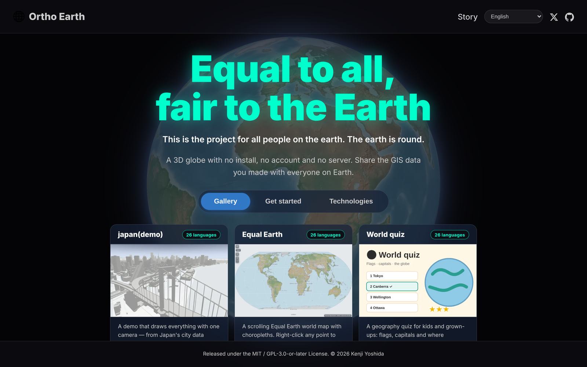
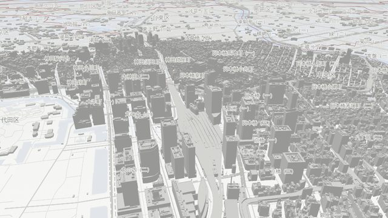
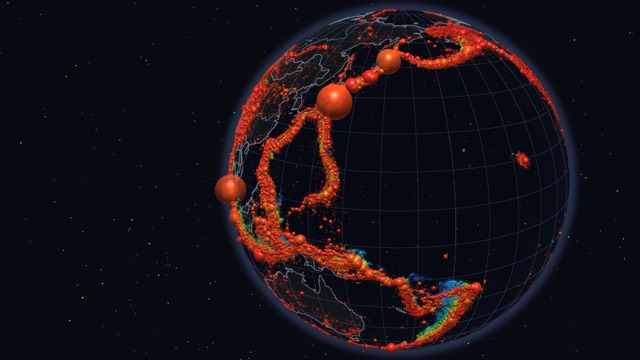
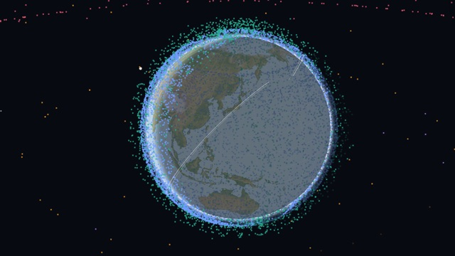
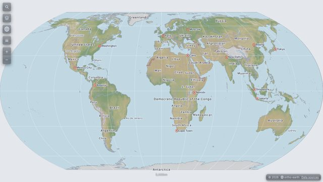

<h1> Ortho Earth</h1>

**maplibre + cesium - mercator = ortho-earth.** The MapLibre GL JS API you already know, on a 3D globe with terrain and 3D Tiles, and no flat Mercator anywhere: the flat world map is Equal Earth.

A serverless WebGPU/GL2 orthographic map engine and GIS workstation, built from scratch — zero runtime dependencies, no tile servers. Runs entirely in the browser.



**top page:** [www.ortho-earth.com](https://www.ortho-earth.com) · **ortho-japan (flagship 3D map):** [/japan/](https://www.ortho-earth.com/japan/) · **world globe:** [/globe/](https://www.ortho-earth.com/globe/) · **GIS-HUB (apps):** [/gishub/](https://www.ortho-earth.com/gishub/) · **MapLibre examples:** [/maplibre/](https://www.ortho-earth.com/maplibre/) · **technical documents:** [/#technologies](https://www.ortho-earth.com/#technologies)

**Demos:**

<table>
<tr>
<td><a href="https://www.ortho-earth.com/japan/#16/35.6812/139.7671/60t/30r"></a><br>Tokyo in 3D (PLATEAU buildings)</td>
<td><a href="https://www.ortho-earth.com/globe/quakes/"></a><br>World earthquakes, 1967 to now</td>
</tr>
<tr>
<td><a href="https://www.ortho-earth.com/globe/sats"></a><br>Satellites in orbit now</td>
<td><a href="https://www.ortho-earth.com/equal/"></a><br>Equal Earth world map</td>
</tr>
</table>

**Guides:** [MapLibre GL JS code on a 3D globe](https://www.ortho-earth.com/docs/from-maplibre) · [Coming from CesiumJS](https://www.ortho-earth.com/docs/from-cesium) · [Equal Earth on the GPU](https://www.ortho-earth.com/docs/equal-earth)

## Why Ortho Earth

- **Always a globe.** There is no flat Mercator mode to switch to or fall back on: orthographic and perspective are one continuum on a sphere (WGS84 ellipsoid optional), from the whole Earth down to street level. What you see at z2 and at z18 is the same model of the world. MapLibre's `projection` is read as "globe" whatever it says, and `renderWorldCopies` has nothing to copy.
- **MapLibre code runs on it.** `@ortho-earth/globe/maplibre` is a `maplibregl` namespace: style.json, expressions, sources (MVT · MLT · PMTiles · GeoJSON · raster · raster-dem · image · video · canvas), `addLayer`/`setPaintProperty`/`queryRenderedFeatures`, paint transitions, light, sky and fog, camera API (`FreeCameraOptions`, padding, constrain), Markers, Popups, Controls, and typings (`maplibre.d.ts`). The gate is MapLibre's own example gallery: of 139 official examples, 66 give the same picture, 50 the same answer and 21 run (none fail to run; graded on `@ortho-earth/globe` 1.16.0). The ledger is [`packages/globe/maplibre-compat.md`](packages/globe/maplibre-compat.md); the gallery with every example's source, match score and a Run button is [www.ortho-earth.com/maplibre/](https://www.ortho-earth.com/maplibre/).
- **Extension points, one shape.** Every extension is `definePlugin({ name, install(map, opts) })`, installed with `map.use(plugin)`. Plugins register into `map.registry` (data kinds, gadgets, tile formats, light types, clouds, post-process passes, handlers, texture transcoders), and `map.supports(key)` / `map.capabilities()` answer honestly what is built in, what a plugin renders, and what is only accepted as a spec. Handbook: [`packages/globe/PLUGINS.md`](packages/globe/PLUGINS.md); the ledger of extension points is `maplibre-compat.md` §9.
- **WebGPU first, WebGL2 always.** Shadows, ambient occlusion, clipping planes and atmospheric scattering on WebGPU; the same map, minus those, on WebGL2.
- **Reads the formats you already have.** 3D Tiles (b3dm · i3dm · pnts · cmpt · glb), I3S, COPC point clouds, quantized-mesh and raster-dem terrain, COG, WMS/WMTS, CZML/KML/GPX, GeoParquet, FlatGeobuf, Shapefile, GeoPackage, File Geodatabase, MVT and MLT — in the browser, with no server of your own ([`geopbf`](packages/geopbf): 18 formats in, 14 out).
- **Data layers without a second engine.** `map.addData(array, { kind, getPosition, getColor, … })` takes an array or GeoJSON with accessor functions: points, arcs, polygons, paths, columns and trips, with GPU range filters, brushing and masks. `map.addH3` / `addCells` (grid · geohash · quadkey · S2) / `addContour` / `addScreenGrid` bin points into cells, isolines and screen grids. deck.gl's `MapboxOverlay` and MapLibre-style custom layers (in the render worker, occluded by terrain and buildings) and three.js modules ride on the same camera.
- **Analysis built in.** Sun shadows and shadow hours, viewshed, line of sight, profiles, clipping, measurement, `sampleTerrain`, sun and moon position. 26 UI languages.
- **React, if you want it.** [`@ortho-earth/react`](sdk/react): `<Globe>`, `<Source>`, `<Layer>`, `<Data>`, `<Marker>`, `useGlobe`, `useGlobeEvent`.

## Quick start

```
npm i @ortho-earth/globe
```

```js
import { createGlobe } from "@ortho-earth/globe";

const map = await createGlobe({ target: "#map", view: "#3/20/140" });
map.flyTo({ center: [139.767, 35.681], zoom: 14, pitch: 60 });
```

Or keep your MapLibre code as it is:

```js
import maplibregl from "@ortho-earth/globe/maplibre";

const map = new maplibregl.Map({ container: "map", style: "https://demotiles.maplibre.org/style.json", center: [139.77, 35.68], zoom: 3 });
```

For Japan, [`@ortho-earth/japan`](sdk/japan) is a self-contained bundle of the same engine plus the Japan region pack (GSI vector tiles, DEM, PLATEAU buildings, POI, search).

**Upgrading from 1.x?** 2.0 removes the aliases and internal import paths that 1.x kept for compatibility. [`MIGRATION.md`](MIGRATION.md) lists every change, old → new, per package (in Japanese).

## Repository layout

The monorepo is one npm workspace (`packages/*`, `sdk/*` and `apps/*`). Parts are arranged in four layers, hard at the top and soft at the bottom, with the SDKs beside them in `sdk/` ([`LAYERS.md`](LAYERS.md)):

| Layer | Where | What |
|---|---|---|
| core | [`packages/ortho-core`](packages/ortho-core) (`@ortho-earth/core`) | Rendering, camera, projection, Gint, overlay contract. Knows no region |
| globe | [`packages/globe`](packages/globe) (`@ortho-earth/globe`) | The globe host: boot, world layers, region-independent gadgets, the MapLibre face, plugins, SDK types, gates |
| region pack | [`packages/jp`](packages/jp) (`@ortho-earth/jp`) | A region's declaration (terrain, buildings, basemap, rasters, search, POI, rail) and the parts only that region needs |
| apps | [`apps/*`](apps) | Shells. `japan` = globe + jp pack + Japanese UI; `world`, `equal`, `census2020`, `solar`, … |
| sdk | [`sdk/*`](sdk) | SDKs and standalone tools for outside users: `@ortho-earth/japan` (the Japan SDK bundle), React bindings, KTX2, Google 3D Tiles, scene and splat plugins, `glbconv` |

Region names never appear in core or globe code (the `verify:regionless` gate counts them). Apps without a region load the shared engine from a versioned, immutable URL (`www.ortho-earth.com/globe/engine/<hash>/`); the Japan apps are two-stage: shared engine + their own bundle with `orthoJapan` and the jp pack.

### Packages

| Package | Version | License | What it is |
|---|---|---|---|
| [`@ortho-earth/core`](packages/ortho-core) | 2.2.0 | GPL-3.0-or-later | Spherical vector-tile rendering engine shared by every ortho app |
| [`@ortho-earth/globe`](packages/globe) | 2.2.0 | GPL-3.0-or-later | The 3D globe: `createGlobe()`, MapLibre-shaped API, plugins, data layers, analysis |
| [`@ortho-earth/jp`](packages/jp) | 0.0.1 (private) | GPL-3.0-or-later | Japan region pack |
| [`@ortho-earth/h3`](packages/h3) | 0.2.0 | GPL-3.0-or-later | H3 cells, binning and `map.addH3()` |
| [`@ortho-earth/tile-formats`](packages/tile-formats) | 0.2.0 | GPL-3.0-or-later | Format plugins loaded on demand: MLT tiles, LAZ records for COPC |
| [`@ortho-earth/ephem`](packages/ephem) | 1.3.0 | GPL-3.0-or-later | Solar-system ephemeris, shared clock, SGP4/SDP4 satellites |
| [`geopbf`](packages/geopbf) | 2.1.0 | MIT | GeoPBF container + Gint topology; converts 18 GIS formats in the browser (workers + WASM) |
| [`geoedit`](packages/geoedit) | 0.4.0 | MIT | Topological GeoPBF editor on the sphere, mounted as a map gadget |
| [`altpbf`](packages/altpbf) | 1.2.0 | MIT | Binary elevation tiles: delta-coded SVarint grids, decoded straight into `Int16Array` |
| [`native-bucket`](packages/native-bucket) | 1.1.0 | MIT | Cloudflare R2 ⇄ browser IndexedDB bridge for heavy binary datasets |
| [`common`](packages/common) | 1.0.0 (private) | MIT | Small shared helpers |
| [`quiet-mono`](packages/quiet-mono) | 1.0.1 | GPL-3.0-or-later | Design kit (tokens and UI parts) shared by the ortho apps |
| [`world-data`](packages/world) | 2.0.0 (private) | CC BY-SA 4.0 (data) | Countries and territories (262) and landforms (~900) with names in 26 languages; sky names (constellations, Messier objects, Solar-System bodies, 2,023 lunar place names) in `sky/` |

`geopbf` and `altpbf` are also published to standalone repositories as read-only mirrors on each release.

### SDKs and tools

Published for outside users from [`sdk/*`](sdk).

| Package | Version | License | What it is |
|---|---|---|---|
| [`@ortho-earth/japan`](sdk/japan) | 2.0.2 | GPL-3.0-or-later | Self-contained Japan globe for any web page: the engine plus the Japan region pack, no API keys or servers |
| [`@ortho-earth/react`](sdk/react) | 0.1.0 | GPL-3.0-or-later | React bindings for the globe |
| [`@ortho-earth/google-tiles`](sdk/google-tiles) | 0.1.0 | GPL-3.0-or-later | Google Photorealistic 3D Tiles: API key and session handling plus attribution |
| [`@ortho-earth/ktx2`](sdk/ktx2) | 0.1.0 | GPL-3.0-or-later | KTX2 / Basis Universal texture transcoder for glb models and 3D Tiles |
| [`@ortho-earth/plugin-scene`](sdk/plugin-scene) | 0.1.0 | GPL-3.0-or-later | Instanced meshes, billboards and 3D text as `map.addData` kinds |
| [`@ortho-earth/plugin-splat`](sdk/plugin-splat) | 0.5.0 | GPL-3.0-or-later | Gaussian splats (`.ply` / `.splat` / `.spz` / `.ksplat` / `.sog`, and 3D Tiles with `KHR_gaussian_splatting`) as a `map.addData` kind: WebGPU renderer with spherical harmonics, GPU sort and LoD, files read in a worker, WebGL2 fallback |
| [`@ortho-earth/plugin-voxel`](sdk/plugin-voxel) | 0.4.0 | GPL-3.0-or-later | Voxel grids (box or longitude × latitude × height region, scalar or RGBA, and 3D Tiles with `EXT_primitive_voxels`) as a `map.addData` kind: ray-marched as a volume, blocks or isosurface, with slicing, scene depth and picking; WebGPU (shared device and depth) or WebGL2 |
| [`glbconv`](sdk/glbconv) | 0.2.0 | MIT | GLB to other 3D formats, browser and Node |

### Apps

Every page under `apps/*` is a shell over the packages above. The ones that are public today:

| URL | App | What it shows |
|---|---|---|
| [/japan/](https://www.ortho-earth.com/japan/) | `apps/ortho-japan` | The flagship: Japan from public data only (GSI, PLATEAU, JAXA). Also `/japan/terrain`, `/japan/parks`, `/japan/models`, `/japan/fireworks`, `/japan/scene`, `/japan/tellus`, `/japan/geoedit` |
| [/globe/](https://www.ortho-earth.com/globe/) | `apps/ortho-globe` | The world globe. `/globe/physical` (landforms), `/globe/parks` (US national parks), `/globe/sats`, `/globe/clouds`, `/globe/?start=equal` (Equal Earth) |
| [/globe/engine/](https://www.ortho-earth.com/globe/engine/current.json) | `apps/engine` | The shared engine: one versioned build of `@ortho-earth/globe` and the modules two or more apps use, loaded by URL |
| [/globe/quakes/](https://www.ortho-earth.com/globe/quakes/) | `apps/quakes` | World earthquakes since 1967 at their true hypocenter depth (data: `apps/quakes-mirror` + USGS, fetched by the browser) |
| [/world/](https://www.ortho-earth.com/world/) | `apps/world` | Nations of the world as cards |
| [/quiz/](https://www.ortho-earth.com/quiz/) | `apps/world-quiz` | Geography quiz on the globe |
| [/japan/census2020/](https://www.ortho-earth.com/japan/census2020/) | `apps/census2020` | Japan's 2020 census, small-area statistics and risk zones |
| [/solar/](https://www.ortho-earth.com/solar/) | `apps/solar` | The planets and their moons, now and replayed over time |
| [/himekuri/](https://www.ortho-earth.com/himekuri/) | `apps/himekuri` | Daily calendar with sunrise, sunset, twilight and the Moon. Owns the npm package [`himekuri`](apps/himekuri/lib) (2.0.0, MIT, tear-off calendar and world-clock SVG widgets) |
| [/nl/](https://www.ortho-earth.com/nl/) | `apps/ortho-nl` | The Netherlands from 3DBAG |
| [/geopbf/](https://www.ortho-earth.com/geopbf/) | `apps/geopbf-demo` | Drop a GIS file, check it on the globe, write it in another format |
| [/gishub-jp/](https://www.ortho-earth.com/gishub-jp/) | `apps/gishub-jp` | Japan's open GIS data: view and convert |
| [/](https://www.ortho-earth.com/) | `apps/www` | Top page, demo cards, the `/maplibre/` gallery and `/docs/` |

`apps/uploader` (bakes data and puts it in the bucket), `apps/account` (per-user file storage Worker), `apps/quakes-mirror` and `apps/sats-mirror` (Workers that mirror the USGS and CelesTrak feeds) are internal.

## Development

Node 22.18 or newer (the tests import `.ts` sources directly, which needs Node's built-in type stripping) and npm. `npm install` at the root installs every workspace.

- `npm run dev:www` — the top page with the demo cards; each app has its own `npm run dev -w <app>` (for example `-w ortho-japan`, `-w ortho-globe`).
- `npm run build:all` — builds www, geopbf-demo, gishub-jp and world and assembles `apps/www/dist` (docs, geopbf, gishub-jp, world, the shared engine).
- Each package README documents its own API; [`packages/globe/README.md`](packages/globe/README.md) is the place to start for the engine, [`packages/geopbf/README.md`](packages/geopbf/README.md) for the data layer.

## Tests

`npm test` at the repository root runs every Node-only test suite in the monorepo (`scripts/test-all.mjs`: the suites of each
workspace are unrolled to their test files, about 190 of them, and run in parallel, no browser or network needed;
`npm run test:list` shows the files, `npm test -- geopbf` runs a subset, `TEST_JOBS=1` runs them one by one).
`npm run verify:i18n` at the root runs the i18n gates of all apps. Browser suites stay per package: `npm run verify:ui` / `verify:webgpu` / `verify:nocoi` / `verify:examples` in `packages/globe`,
`npm run verify:ui` / `verify:webgpu` / `verify:prod` in `apps/ortho-japan`, `npm run verify:pages` in `packages/geopbf`,
`npm run verify:gpu` in `apps/equal`. They drive a pinned headless Chrome for Testing (downloaded once, about 150 MB, to `~/.cache/ortho-earth/chrome-for-testing`;
`npm run chrome:install` in `packages/globe` fetches it ahead of time, `CHROME=<path>` overrides it). It is a separate app from your everyday Google Chrome,
so a running suite never blocks you from opening Chrome. The WebGPU suites need a real GPU.

## Deploying

There is no CI/CD workflow in this repository (only GitHub's CodeQL scan runs on push). Publishing is done from a machine with a logged-in `wrangler`:

- **Shared engine** (`apps/engine`, Worker `ortho-engine`): `npm run deploy:engine` at the root. It first builds `ortho-globe` and runs its `verify:prod` against the new engine, then deploys the engine, then every app that loads it (`ortho-globe`, `census2020`, `ortho-nl`, `world-quiz`, `choju`, `yokohama`, `world`, `equal`, `ortho-japan`). Each app's own deploy refuses to go out if the engine version it was built against is not live yet.
- **Workers** (`ortho-japan`, `ortho-globe`, `world`, `ortho-equal`, `census2020`, `ortho-solar`, `ortho-nl`, `ortho-himekuri`, `ortho-world-quiz`, …; one `wrangler.toml` per app): `npm run deploy -w <app>`. Each app's deploy script runs its own gates first (i18n tables, `verify:prod`, tests) and then `wrangler deploy`; `apps/ortho-japan` uses `scripts/deploy.mjs`.
- **www** (`www.ortho-earth.com`, Cloudflare Pages): published automatically when `main` is merged, through the Pages Git integration. No manual `wrangler pages deploy` is needed.
- **Order matters.** Because www goes live on merge, deploy the Workers first, and the shared engine before the apps that load it (its URL is a content hash of its build; older entry points are redirected to the current version by the `ortho-engine` Worker).
- Bulk data (`world`, `space`, GeoPBF archives) lives in a Cloudflare R2 bucket and is uploaded with `apps/uploader`.

## Contributors & Acknowledgments

This project is fully engineered and conceptualized by Kenji Yoshida.
I also acknowledge the invaluable support of my AI collaborators:

- **Claude** (Anthropic) & **Gemini** (Google) - AI Collaborators for architectural ideation, coding, and technical writing.

## License

- Engine, apps & SDKs (`@ortho-earth/core`, `@ortho-earth/globe`, `@ortho-earth/jp`, `@ortho-earth/h3`, `@ortho-earth/tile-formats`, `@ortho-earth/ephem`, `quiet-mono`, `apps/*`, `sdk/*` except `glbconv`): **GPL-3.0-or-later**
- Data formats & utilities (`geopbf`, `geoedit`, `altpbf`, `glbconv`, `native-bucket`, `common`, `himekuri`, `apps/world`): **MIT**
- Data package (`world-data`, including its `sky/` names): **CC BY-SA 4.0** (lunar place names from USGS are public domain)

For commercial use without GPL obligations, a separate commercial license is available — contact kenji.yoshida.home.2026@gmail.com.
