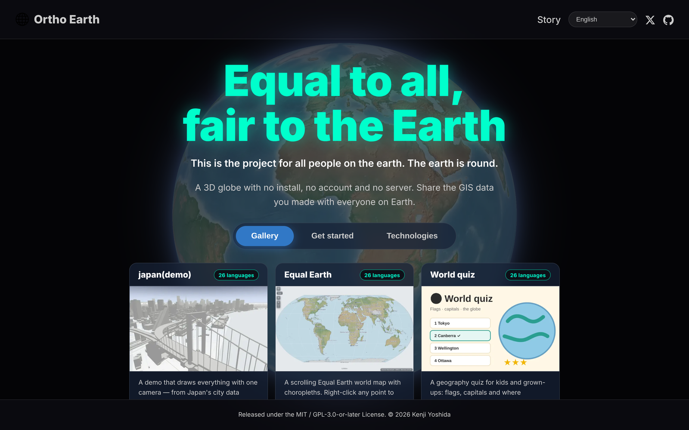
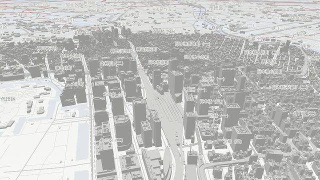
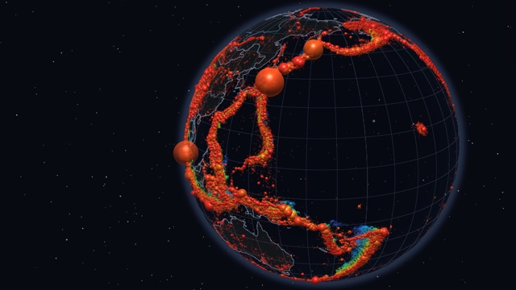
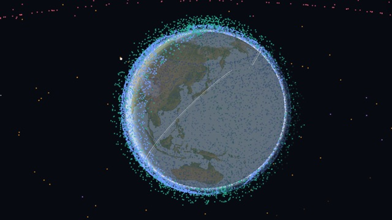
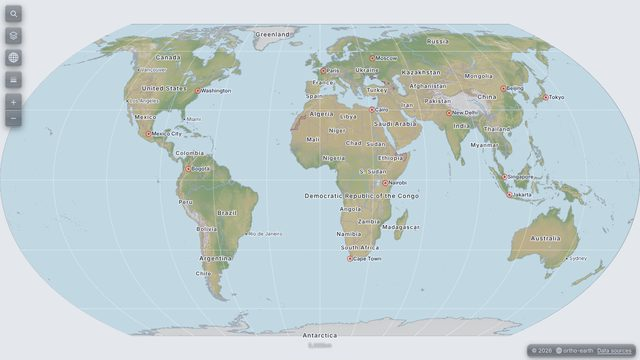

<h1> Ortho Earth</h1>

**maplibre + cesium - mercator = ortho-earth.** The MapLibre GL JS API you already know, on a 3D globe with terrain and 3D Tiles, and no flat Mercator anywhere: the flat world map is Equal Earth.

A serverless WebGPU/GL2 orthographic map engine and GIS workstation, built from scratch — zero runtime dependencies, no tile servers. Runs entirely in the browser.

<a href="https://www.ortho-earth.com"></a>

**top page:** [www.ortho-earth.com](https://www.ortho-earth.com) · **ortho-japan (flagship 3D map):** [/japan/](https://www.ortho-earth.com/japan/) · **world globe:** [/globe/](https://www.ortho-earth.com/globe/) · **GIS-HUB (apps):** [/gishub/](https://www.ortho-earth.com/gishub/) · **MapLibre examples:** [/maplibre/](https://www.ortho-earth.com/maplibre/) · **technical documents:** [/#technologies](https://www.ortho-earth.com/#technologies)

**Demos:**

<table>
<tr>
<td><a href="https://www.ortho-earth.com/japan/#16/35.6812/139.7671/60t/30r"></a><br>Tokyo in 3D (PLATEAU buildings)</td>
<td><a href="https://www.ortho-earth.com/globe/quakes/"></a><br>World earthquakes, 1967 to now</td>
</tr>
<tr>
<td><a href="https://www.ortho-earth.com/globe/sats"></a><br>Satellites in orbit now</td>
<td><a href="https://www.ortho-earth.com/equal/"></a><br>Equal Earth world map</td>
</tr>
</table>

**Guides:** [MapLibre GL JS code on a 3D globe](https://www.ortho-earth.com/docs/from-maplibre) · [Coming from CesiumJS](https://www.ortho-earth.com/docs/from-cesium) · [Equal Earth on the GPU](https://www.ortho-earth.com/docs/equal-earth)

## Why Ortho Earth

- **Always a globe.** There is no flat Mercator mode to switch to or fall back on: orthographic and perspective are one continuum on a sphere (WGS84 ellipsoid optional), from the whole Earth down to street level. What you see at z2 and at z18 is the same model of the world. MapLibre's `projection` is read as "globe" whatever it says, and `renderWorldCopies` has nothing to copy.
- **MapLibre code runs on it.** `@ortho-earth/globe/maplibre` is a `maplibregl` namespace: style.json, expressions, sources (MVT · MLT · PMTiles · GeoJSON · raster · raster-dem · image · video · canvas), `addLayer`/`setPaintProperty`/`queryRenderedFeatures`, paint transitions, light, sky and fog, camera API (`FreeCameraOptions`, padding, constrain), Markers, Popups, Controls, and typings (`maplibre.d.ts`). The gate is MapLibre's own example gallery: of the 137 scorable official examples, 91 give the same picture, 43 the same answer and 3 run (none fail to run; graded on `@ortho-earth/globe` 2.3.0). The ledger is [`packages/globe/maplibre-compat.md`](packages/globe/maplibre-compat.md); the gallery with every example's source, match score and a Run button is [www.ortho-earth.com/maplibre/](https://www.ortho-earth.com/maplibre/).
- **CesiumJS code runs on it, too.** `import * as Cesium from "@ortho-earth/cesium"` gives CesiumJS's names (Viewer, Camera, entities, data sources, clock, 3D Tiles, picking); everything that does not draw is Cesium's own code, and the drawing is the Ortho Earth globe. Of 303 graded Sandcastle examples, 226 give the same picture and 77 the same answer (none only run, none fail to run; `@ortho-earth/cesium` 0.2.0). Every pair side by side: [www.ortho-earth.com/sandcastle/](https://www.ortho-earth.com/sandcastle/).
- **Extension points, one shape.** Every extension is `definePlugin({ name, install(map, opts) })`, installed with `map.use(plugin)`. Plugins register into `map.registry` (data kinds, gadgets, tile formats, light types, clouds, post-process passes, handlers, texture transcoders), and `map.supports(key)` / `map.capabilities()` answer honestly what is built in, what a plugin renders, and what is only accepted as a spec. Handbook: [`packages/globe/PLUGINS.md`](packages/globe/PLUGINS.md); the ledger of extension points is `maplibre-compat.md` §9.
- **WebGPU first, WebGL2 always.** Shadows, ambient occlusion, clipping planes and atmospheric scattering on WebGPU; the same map, minus those, on WebGL2.
- **Reads the formats you already have.** 3D Tiles (b3dm · i3dm · pnts · cmpt · glb), I3S, COPC point clouds, quantized-mesh and raster-dem terrain, COG, WMS/WMTS, CZML/KML/GPX, GeoParquet, FlatGeobuf, Shapefile, GeoPackage, File Geodatabase, MVT and MLT — in the browser, with no server of your own ([`geopbf`](packages/geopbf): 18 formats in, 14 out).
- **Data layers without a second engine.** `map.addData(array, { kind, getPosition, getColor, … })` takes an array or GeoJSON with accessor functions: points, arcs, polygons, paths, columns and trips, with GPU range filters, brushing and masks. `map.addH3` / `addCells` (grid · geohash · quadkey · S2) / `addContour` / `addScreenGrid` bin points into cells, isolines and screen grids. deck.gl's `MapboxOverlay` and MapLibre-style custom layers (in the render worker, occluded by terrain and buildings) and three.js modules ride on the same camera.
- **Analysis built in.** Sun shadows and shadow hours, viewshed, line of sight, profiles, clipping, measurement, `sampleTerrain`, sun and moon position. 26 UI languages.
- **React, if you want it.** [`@ortho-earth/react`](sdk/react): `<Globe>`, `<Source>`, `<Layer>`, `<Data>`, `<Marker>`, `useGlobe`, `useGlobeEvent`.

## Limits

- **Browsers.** A browser that has WebGPU starts on it: desktop Chrome and Edge, Safari on macOS, iOS and iPadOS, and Chrome on Android (macOS, Windows, iOS, iPadOS and one Android tablet, Mali-G615, checked on real devices). Android drivers vary: one entry-level phone once showed a silent black base map on WebGPU, which the engine cannot detect, so if the map goes black, add `?gl2=1`. Where WebGPU is missing, fails to start or shows no picture in a way the engine can see, the map restarts on WebGL2 by itself. `?gl2=1` forces WebGL2 and `?gpu=1` forces WebGPU. [www.ortho-earth.com/check/](https://www.ortho-earth.com/check/) shows which path your device takes, with its GPU and a draw test, as a report you can copy (nothing is sent).
- **WebGPU only.** Shadows, ambient occlusion, clipping planes, atmospheric scattering and the `setPostChain` effects (`ssr`, `contactShadow`, `heightFog`, `godRays`, `rain`, `toon`). On WebGL2 they do nothing; the map itself is the same.
- **Not built, on purpose.** No flat Mercator mode (the flat world map is Equal Earth), no native mobile SDK, no conversion or tile server.
- **Not the same picture yet.** MapLibre: 46 of 137 graded examples ([/maplibre/](https://www.ortho-earth.com/maplibre/), ledger [`maplibre-compat.md`](packages/globe/maplibre-compat.md)). CesiumJS: 77 of 303 ([/sandcastle/](https://www.ortho-earth.com/sandcastle/)). Each one shows its score next to the original.
- **License.** GPL-3.0 for the engine; see the paragraph under Quick start.

## Quick start

```
npm i @ortho-earth/globe
```

```js
import { createGlobe } from "@ortho-earth/globe";

const map = await createGlobe({ target: "#map", view: "#3/20/140" });
map.flyTo({ center: [139.767, 35.681], zoom: 14, pitch: 60 });
```

Or keep your MapLibre code as it is:

```js
import * as maplibregl from "@ortho-earth/globe/maplibre";

const map = new maplibregl.Map({ container: "map", style: "https://demotiles.maplibre.org/style.json", center: [139.77, 35.68], zoom: 3 });
```

For Japan, [`@ortho-earth/japan`](sdk/japan) is a self-contained bundle of the same engine plus the Japan region pack (GSI vector tiles, DEM, PLATEAU buildings, POI, search).

**Upgrading from 1.x?** 2.0 removes the aliases and internal import paths that 1.x kept for compatibility. [`MIGRATION.md`](MIGRATION.md) lists every change, old → new, per package (in Japanese).

**License in one paragraph.** Ortho Earth is free to use for any purpose, commercial included, under GPL-3.0. Bundling it into a web page counts as distribution, so that page's own JavaScript must also be released under the GPL. If you cannot do that, a commercial license is available: contact kenji.yoshida.home.2026@gmail.com. The data-format libraries (`geopbf`, `altpbf`, `geoedit`, `glbconv`) are MIT and have no such condition. Details: [License](#license).

## Repository layout

The monorepo is one npm workspace (`packages/*`, `sdk/*` and `apps/*`). Parts are arranged in four layers, hard at the top and soft at the bottom, with the SDKs beside them in `sdk/` ([`LAYERS.md`](LAYERS.md)):

| Layer | Where | What |
|---|---|---|
| core | [`packages/ortho-core`](packages/ortho-core) (`@ortho-earth/core`) | Rendering, camera, projection, Gint, overlay contract. Knows no region |
| globe | [`packages/globe`](packages/globe) (`@ortho-earth/globe`) | The globe host: boot, world layers, region-independent gadgets, the MapLibre face, plugins, SDK types, gates |
| region pack | [`packages/jp`](packages/jp) (`@ortho-earth/jp`), [`packages/nl`](packages/nl) (`@ortho-earth/nl`) | A region's declaration (terrain, buildings, basemap, rasters, search, POI, rail) and the parts only that region needs. [`packages/regions`](packages/regions) is the switch that picks one; the packs never know each other |
| apps | [`apps/*`](apps) | Shells. `japan` = globe + jp pack + Japanese UI; `world`, `equal`, `census2020`, `solar`, … |
| sdk | [`sdk/*`](sdk) | SDKs and standalone tools for outside users: `@ortho-earth/japan` (the Japan SDK bundle), React bindings, KTX2, Google 3D Tiles, Google Maps API on MapLibre, scene and splat plugins, `glbconv` |

Region names never appear in core or globe code (the `verify:regionless` gate counts them). Apps without a region load the shared engine from a versioned, immutable URL (`www.ortho-earth.com/globe/engine/<hash>/`); the Japan apps are two-stage: shared engine + their own bundle with `orthoJapan` and the jp pack.

Design notes and plans for contributors (the fallback ladder, the Gint draw spec, performance plans) live in [`docs/`](docs).

### Packages

| Package | Version | License | What it is |
|---|---|---|---|
| [`@ortho-earth/core`](packages/ortho-core) | 2.3.0 | GPL-3.0-or-later | Spherical vector-tile rendering engine shared by every ortho app |
| [`@ortho-earth/globe`](packages/globe) | 2.3.0 | GPL-3.0-or-later | The 3D globe: `createGlobe()`, MapLibre-shaped API, plugins, data layers, analysis |
| [`@ortho-earth/jp`](packages/jp) | 0.0.1 (private) | GPL-3.0-or-later | Japan region pack |
| [`@ortho-earth/nl`](packages/nl) | 0.0.1 (private) | GPL-3.0-or-later | Netherlands region pack (3D Basisvoorziening buildings, basemap, elevation) |
| [`@ortho-earth/regions`](packages/regions) | 0.0.1 (private) | GPL-3.0-or-later | Region switch (`orthoJapan`): the globe plus the region chosen by URL (Japan or the Netherlands) |
| [`@ortho-earth/equal`](packages/equal) | 0.0.1 (private) | GPL-3.0-or-later | Equal Earth world map (`createEqual`), shared by `/equal/`, `/globe/` and `/japan/` through the shared engine |
| [`@ortho-earth/h3`](packages/h3) | 0.2.0 | GPL-3.0-or-later | H3 cells, binning and `map.addH3()` |
| [`@ortho-earth/tile-formats`](packages/tile-formats) | 0.2.0 | GPL-3.0-or-later | Format plugins loaded on demand: MLT tiles, LAZ records for COPC |
| [`@ortho-earth/ephem`](packages/ephem) | 1.3.0 | GPL-3.0-or-later | Solar-system ephemeris, shared clock, SGP4/SDP4 satellites |
| [`geopbf`](packages/geopbf) | 2.1.1 | MIT | GeoPBF container + Gint topology; converts 18 GIS formats in the browser (workers + WASM) |
| [`geoedit`](packages/geoedit) | 0.4.0 | MIT | Topological GeoPBF editor on the sphere, mounted as a map gadget |
| [`altpbf`](packages/altpbf) | 1.2.0 | MIT | Binary elevation tiles: delta-coded SVarint grids, decoded straight into `Int16Array` |
| [`native-bucket`](packages/native-bucket) | 1.1.0 | MIT | Cloudflare R2 ⇄ browser IndexedDB bridge for heavy binary datasets |
| [`common`](packages/common) | 1.0.0 (private) | MIT | Small shared helpers |
| [`quiet-mono`](packages/quiet-mono) | 1.0.1 | GPL-3.0-or-later | Design kit (tokens and UI parts) shared by the ortho apps |
| [`world-data`](packages/world) | 2.0.0 (private) | CC BY-SA 4.0 (data) | Countries and territories (262) and landforms (~900) with names in 26 languages; sky names (constellations, Messier objects, Solar-System bodies, 2,023 lunar place names) in `sky/` |

`geopbf` and `altpbf` are also published to standalone repositories as read-only mirrors on each release.

### SDKs and tools

Published for outside users from [`sdk/*`](sdk).

| Package | Version | License | What it is |
|---|---|---|---|
| [`@ortho-earth/japan`](sdk/japan) | 2.0.2 | GPL-3.0-or-later | Self-contained Japan globe for any web page: the engine plus the Japan region pack, no API keys or servers |
| [`@ortho-earth/react`](sdk/react) | 0.1.0 | GPL-3.0-or-later | React bindings for the globe |
| [`@ortho-earth/google3d`](sdk/google3d) | 0.2.0 | GPL-3.0-or-later | Google Photorealistic 3D Tiles: API key and session handling plus attribution |
| [`@ortho-earth/gmaps`](sdk/gmaps) | 0.2.0 | GPL-3.0-or-later | Google Maps JavaScript API on MapLibre: a `google.maps` namespace (Map, Marker, InfoWindow, shapes, Data, geometry) for maplibre-gl or the globe; with an API key, Geocoder, Directions, Places and Street View are relayed to Google |
| [`@ortho-earth/leaflet`](sdk/leaflet) | 0.1.0 | GPL-3.0-or-later | Leaflet on MapLibre: an `L` namespace (map, marker, popup, tooltip, tileLayer / WMS, polyline, polygon, circle, geoJSON, controls) for maplibre-gl or the globe |
| [`@ortho-earth/ktx2`](sdk/ktx2) | 0.1.0 | GPL-3.0-or-later | KTX2 / Basis Universal texture transcoder for glb models and 3D Tiles |
| [`@ortho-earth/scene`](sdk/scene) | 0.2.0 | GPL-3.0-or-later | Instanced meshes, billboards and 3D text as `map.addData` kinds |
| [`@ortho-earth/splat`](sdk/splat) | 0.6.0 | GPL-3.0-or-later | Gaussian splats (`.ply` / `.splat` / `.spz` / `.ksplat` / `.sog`, and 3D Tiles with `KHR_gaussian_splatting`) as a `map.addData` kind: WebGPU renderer with spherical harmonics, GPU sort and LoD, files read in a worker, WebGL2 fallback |
| [`@ortho-earth/voxel`](sdk/voxel) | 0.6.1 | GPL-3.0-or-later | Voxel grids (box or longitude × latitude × height region, scalar or RGBA, and 3D Tiles with `EXT_primitive_voxels`) as a `map.addData` kind: ray-marched as a volume, blocks or isosurface, with slicing, scene depth and picking; WebGPU (shared device and depth) or WebGL2 |
| [`@ortho-earth/cesium`](sdk/cesium) | 0.2.0 | GPL-3.0-or-later | CesiumJS API on ortho-earth: a `Cesium` namespace (Viewer, Camera, entities, data sources, clock, 3D Tiles, picking) drawn by `@ortho-earth/globe`; math, time, Entity/Property and CZML parsing come from `@cesium/engine` unchanged |
| [`glbconv`](sdk/glbconv) | 0.2.0 | MIT | GLB to other 3D formats, browser and Node |

### Apps

Every page under `apps/*` is a shell over the packages above. The ones that are public today:

| URL | App | What it shows |
|---|---|---|
| [/japan/](https://www.ortho-earth.com/japan/) | `apps/japan-map` (served by `apps/japan-host`) | The flagship: Japan from public data only (GSI, PLATEAU, JAXA). Also `/japan/terrain`, `/japan/parks`, `/japan/models`, `/japan/onsen`, `/japan/pointcloud`, `/japan/fireworks`, `/japan/scene`, `/japan/tellus`, `/japan/geoedit` (each page is its own folder under `apps/`) |
| [/globe/](https://www.ortho-earth.com/globe/) | `apps/globe-map` (served by `apps/globe-host`) | The world globe. `/globe/physical` (landforms), `/globe/parks` (US national parks), `/globe/sats`, `/globe/clouds`, `/globe/hex` (population in H3), `/globe/arcs`, `/globe/clock`, `/globe/voxel`, `/globe/splat`, `/globe/?start=equal` (Equal Earth) (each page is its own folder under `apps/`) |
| [/globe/engine/](https://www.ortho-earth.com/globe/engine/current.json) | `apps/engine` | The shared engine: one versioned build of `@ortho-earth/globe` and the modules two or more apps use, loaded by URL |
| [/globe/quakes/](https://www.ortho-earth.com/globe/quakes/) | `apps/quakes` | World earthquakes since 1967 at their true hypocenter depth (data: `apps/quakes-mirror` + USGS, fetched by the browser) |
| [/world/](https://www.ortho-earth.com/world/) | `apps/world` | Nations of the world as cards |
| [/equal/](https://www.ortho-earth.com/equal/) | `apps/equal` | Equal Earth world map with choropleths |
| [/yokohama/](https://www.ortho-earth.com/yokohama/) | `apps/yokohama` | Yokohama digital twin for citizens: PLATEAU 3D city, disaster risk, transport, walking routes |
| [/quiz/](https://www.ortho-earth.com/quiz/) | `apps/quiz` | Geography quiz on the globe |
| [/japan/census2020/](https://www.ortho-earth.com/japan/census2020/) | `apps/census2020` | Japan's 2020 census, small-area statistics and risk zones |
| [/solar/](https://www.ortho-earth.com/solar/) | `apps/solar` | The planets and their moons, now and replayed over time |
| [/himekuri/](https://www.ortho-earth.com/himekuri/) | `apps/himekuri` | Daily calendar with sunrise, sunset, twilight and the Moon. Owns the npm package [`himekuri`](apps/himekuri/lib) (2.0.0, MIT, tear-off calendar and world-clock SVG widgets) |
| [/nl/](https://www.ortho-earth.com/nl/) | `apps/ortho-nl` | The Netherlands from 3DBAG |
| [/geopbf/](https://www.ortho-earth.com/geopbf/) | `apps/geopbf-demo` | Drop a GIS file, check it on the globe, write it in another format |
| [/gishub-jp/](https://www.ortho-earth.com/gishub-jp/) | `apps/gishub-jp` | Japan's open GIS data: view and convert |
| [/](https://www.ortho-earth.com/) | `apps/www` | Top page, demo cards, the `/maplibre/` gallery and `/docs/` |

`apps/uploader` (bakes data and puts it in the bucket), `apps/account` (per-user file storage Worker), `apps/quakes-mirror` and `apps/sats-mirror` (Workers that mirror the USGS and CelesTrak feeds) are internal.

## Development

Node 22.18 or newer and npm; `npm install` at the root installs every workspace, `npm test` runs every Node-only suite, `npm run dev:www` starts the top page.
Merges to `main` deploy automatically (engine and apps through GitHub Actions on a self-hosted GPU runner, `www.ortho-earth.com` through Cloudflare Pages).

The full guide (running and building, every test and browser suite, deploy order, npm release, data) is [`docs/development.md`](docs/development.md).
Architecture: [`docs/architecture.md`](docs/architecture.md) · apps and URLs: [`docs/apps.md`](docs/apps.md) · all contributor docs: [`docs/`](docs).

## Contributing

Bug reports, ideas and pull requests are welcome: see [CONTRIBUTING.md](CONTRIBUTING.md). Questions go to [Discussions](https://github.com/kenjiyoshidahome2026-bit/ortho-earth/discussions).
Because Ortho Earth is also offered under a commercial license, contributors sign a short [CLA](CLA.md) on their first pull request.

## Contributors & Acknowledgments

This project is fully engineered and conceptualized by Kenji Yoshida.
I also acknowledge the invaluable support of my AI collaborators:

- **Claude** (Anthropic) & **Gemini** (Google) - AI Collaborators for architectural ideation, coding, and technical writing.

## License

- Engine, apps & SDKs (`@ortho-earth/core`, `@ortho-earth/globe`, `@ortho-earth/jp`, `@ortho-earth/nl`, `@ortho-earth/regions`, `@ortho-earth/equal`, `@ortho-earth/h3`, `@ortho-earth/tile-formats`, `@ortho-earth/ephem`, `quiet-mono`, `apps/*` except `apps/world`, `sdk/*` except `glbconv`): **GPL-3.0-or-later**
- Data formats & utilities (`geopbf`, `geoedit`, `altpbf`, `glbconv`, `native-bucket`, `common`, `himekuri`, `apps/world`): **MIT**
- Data package (`world-data`, including its `sky/` names): **CC BY-SA 4.0** (lunar place names from USGS are public domain)

The root [`LICENSE`](LICENSE) is the GPL-3.0 text that covers most of the repository; every package and app carries its own `LICENSE` file.

For commercial use without GPL obligations, a separate commercial license is available — contact kenji.yoshida.home.2026@gmail.com.
