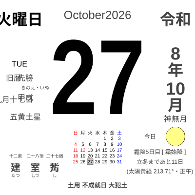

<!-- HERO: GitHub の編集画面で hero/globe-to-tokyo.mp4 をこの行へドラッグすると
     https://github.com/user-attachments/assets/… の URL が入り、自動再生の動画になる。
     この注釈ごと、その URL 一行に置き換える。 -->

<h3 align="center">Equal to all, fair to the Earth</h3>

  A 3D globe that runs in your browser. No server, no account. 
  <a href="https://www.ortho-earth.com/">www.ortho-earth.com</a>

 

**What I make**

- **[ortho-earth](https://github.com/kenjiyoshidahome2026-bit/ortho-earth)** — 3D globe map engine. WebGPU, MapLibre GL JS compatible API, 3D Tiles, terrain at true scale. Starts with about 380 KB.
- **[geopbf](https://github.com/kenjiyoshidahome2026-bit/geopbf)** — carry geometry as geometry. Compact binary for features + GPU-readable topology.
- **[gint](https://github.com/kenjiyoshidahome2026-bit/gint)** — 64-bit geospatial primitive for fast rendering.
- **[altpbf](https://github.com/kenjiyoshidahome2026-bit/altpbf)** — the planet's elevation in 8 tiles / 55 MB.
- **[geoedit](https://github.com/kenjiyoshidahome2026-bit/geoedit)** — topological editor, edits on the sphere.
- **[ortho-world](https://github.com/kenjiyoshidahome2026-bit/ortho-world)** — 262 countries in 26 languages, drop into a `
`.
- **[himekuri](https://github.com/kenjiyoshidahome2026-bit/himekuri)** — the calendar on the right. Lunisolar date, rokuyō, 72 pentads. It tears off one page every midnight (JST).
- **[plateau-bench](https://github.com/kenjiyoshidahome2026-bit/plateau-bench)** — PLATEAU 3D Tiles rendering benchmark, raw results open.

 

**About me** — Semiconductor engineer 30 years, Web engineer 15 years, loves wife and dog, and drives ALPINA D3S touring & Tesla. Yokohama.
[@KenjiYoshida168](https://x.com/KenjiYoshida168)
